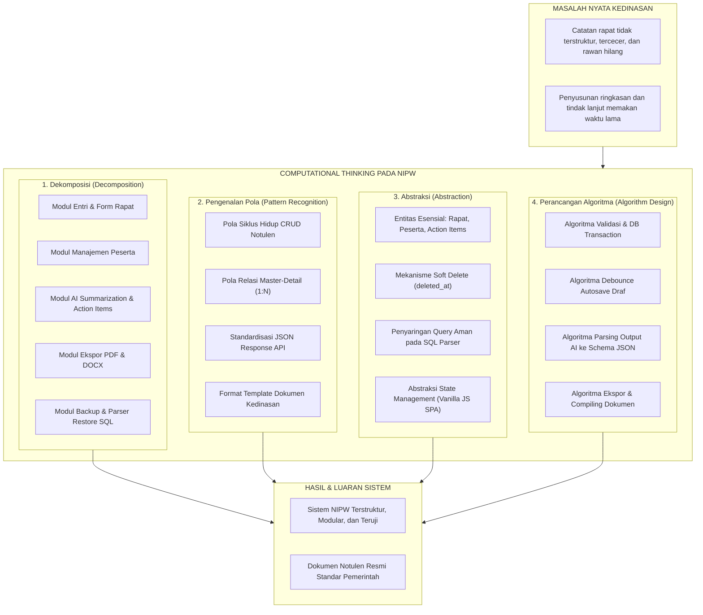
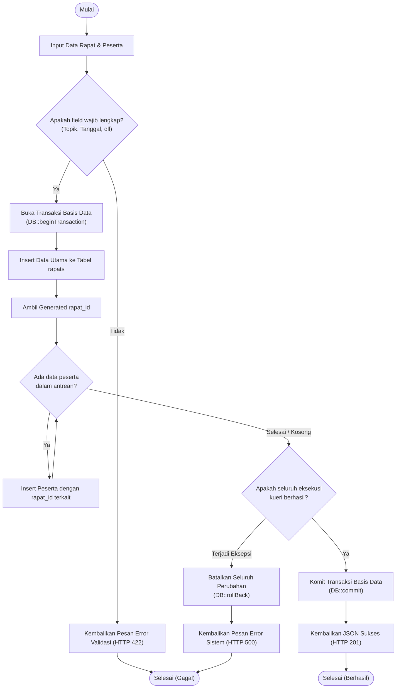
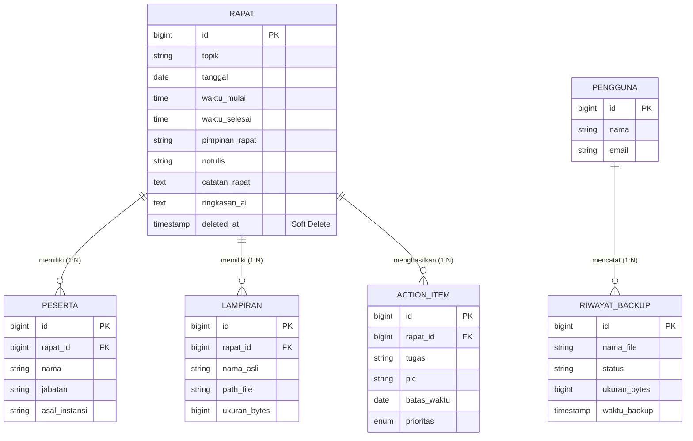

# DOKUMEN DIAGRAM COMPUTATIONAL THINKING
**Mata Kuliah:** Pemrograman Terstruktur [+Praktikum] (4 SKS)  
**Proyek:** Sistem Notulensi Infrastruktur dan Pengembangan Wilayah (NIPW / RapatinAI)

---

## 1. Diagram Kerangka Kerja 4 Pilar Computational Thinking

---

## 2. Diagram Dekomposisi Arsitektur Sistem Terstruktur

```mermaid
flowchart TD
    App["SISTEM INFORMASI NIPW"]

    App --> UI["Lapisan Antarmuka (Presentation Layer)"]
    App --> Logic["Lapisan Logika Terstruktur (Logic/Controller Layer)"]
    App --> Data["Lapisan Data & Persistensi (Data Layer)"]
    App --> Service["Lapisan Layanan Eksternal (Service Layer)"]

    UI --> U1["Beranda & Statistik Kedinasan"]
    UI --> U2["Formulir Notulen & Draf Otomatis"]
    UI --> U3["Riwayat Rapat & Tempat Sampah"]
    UI --> U4["Panel Backup & Restore Database"]

    Logic --> L1["RapatController (CRUD & Validasi)"]
    Logic --> L2["AiController (Pipeline Gemini API)"]
    Logic --> L3["LampiranController (I/O File Storage)"]
    Logic --> L4["BackupController (SQL Dump & Restore Parser)"]

    Data --> D_Rapat[("Tabel rapats")]
    Data --> D_Peserta[("Tabel pesertas")]
    Data --> D_Lampiran[("Tabel lampirans")]
    Data --> D_Action[("Tabel action_items")]
    Data --> D_Backup[("Tabel riwayat_backups")]

    Service --> S_AI["Google Gemini AI API"]
    Service --> S_PDF["DomPDF Engine"]
    Service --> S_Word["PHPWord Engine"]
```

---

## 3. Diagram Alir Algoritma Penyimpanan Rapat Terstruktur

---

## 4. Entity-Relationship Diagram (ERD Basis Data Terstruktur)

